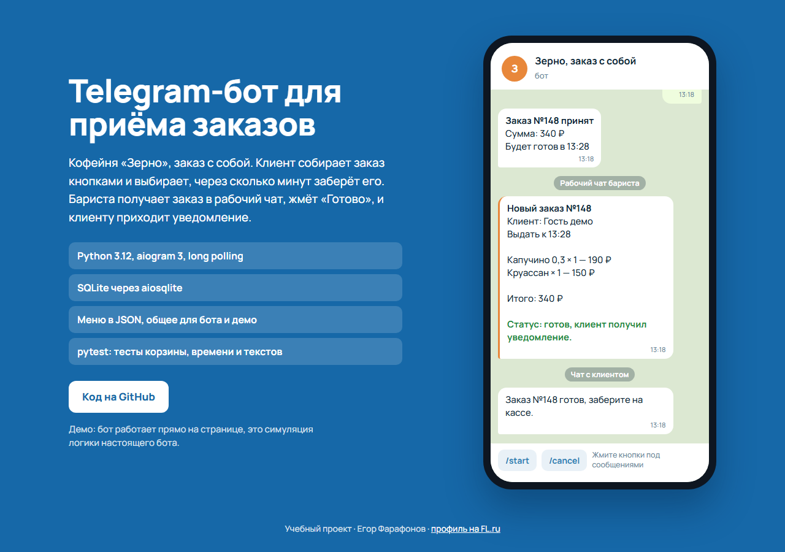

# Бот кофейни «Зерно»

Telegram-бот для заказов с собой в кофейне «Зерно». Кофейня вымышленная, это учебный проект для портфолио.

Демо прямо в браузере: https://xevorin.github.io/zerno-bot/
Страница повторяет логику бота на JavaScript: те же кнопки, тексты и шаги. Telegram и токен для неё не нужны.



## Что умеет бот

- По `/start` здоровается и показывает разделы меню: кофе, не кофе, выпечка.
- В разделе показывает позиции с ценами. У позиции выбирается количество (кнопки − и +), потом «В корзину».
- «Корзина» показывает позиции, количество и итоговую сумму. Корзину можно очистить.
- При оформлении клиент выбирает, когда заберёт заказ: через 10, 20 или 30 минут.
- После подтверждения бот отвечает «Заказ №N принят», пишет сумму и время, к которому заказ будет готов.
- Заказ уходит в рабочий чат бариста (`STAFF_CHAT_ID`) с кнопкой «Готово». Бариста жмёт её, и клиенту приходит «Заказ №N готов, заберите на кассе». Повторное нажатие второго уведомления не шлёт.
- `/cancel` очищает корзину.

Заказы хранятся в SQLite (`data/orders.db`). Корзина живёт в памяти бота (MemoryStorage) и пропадает при перезапуске.

## Стек

- Python 3.12, aiogram 3.13, long polling
- SQLite через aiosqlite
- python-dotenv для настроек
- pytest для тестов
- Демо: HTML, CSS и JavaScript без сборки, GitHub Pages

## Как запустить локально

1. Создайте бота у [@BotFather](https://t.me/BotFather) командой `/newbot` и скопируйте токен.
2. Узнайте id рабочего чата бариста. Добавьте бота в группу и напишите туда сообщение. Потом откройте `https://api.telegram.org/bot<токен>/getUpdates` и найдите `chat.id`: у групп он начинается с `-100`.
3. Установите зависимости и заполните настройки:

```bash
python -m venv .venv
# Windows: .venv\Scripts\activate   macOS/Linux: source .venv/bin/activate
pip install -r requirements.txt
cp .env.example .env        # впишите BOT_TOKEN и STAFF_CHAT_ID
python -m bot.main
```

Файл `.env` лежит в `.gitignore`, токен в репозиторий не попадёт.

Тесты сеть не трогают и запускаются без токена:

```bash
pytest
```

Демо-страницу можно открыть прямо из файла `index.html`. Если браузер не даёт загрузить `data/menu.json` по `file://`, страница берёт встроенную копию меню. Страница с параметром `?demo` сама проигрывает заказ, так снят скриншот выше.

## Структура

```
zerno-bot/
├── bot/
│   ├── main.py        # точка входа: Bot, Dispatcher, polling
│   ├── config.py      # настройки из .env
│   ├── handlers.py    # команды и нажатия кнопок
│   ├── keyboards.py   # inline-клавиатуры и callback data
│   ├── logic.py       # корзина, сумма, время выдачи, номер заказа, тексты
│   └── db.py          # таблица orders в SQLite
├── tests/             # pytest: logic, db, клавиатуры
├── data/menu.json     # меню и цены, общие для бота и демо
├── index.html, sim.css, sim.js   # демо для GitHub Pages
├── requirements.txt
└── .env.example
```

Чтобы поменять меню, правьте `data/menu.json` и перезапустите бота. Демо подхватит то же меню.

---

Учебный проект · Егор Фарафонов · [профиль на FL.ru](https://www.fl.ru/users/farafonovegor07/)
